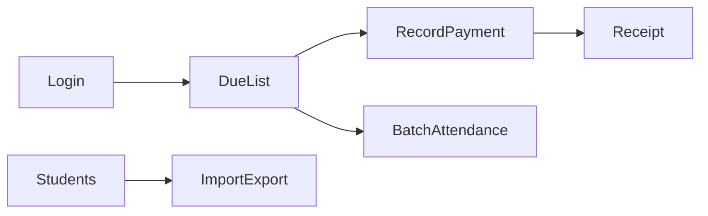

# Mockup design plan

Add one document, [docs/design/mockup-plan.md](docs/design/mockup-plan.md), and link it from the document table in [docs/market-research/school-management/README.md](docs/market-research/school-management/README.md). The repo stays research-and-design docs only. This file is the map for a later clickable prototype. It does not approve Phase 1 interviews or application code.

The product on the screens is the selected position in [product-positioning.md](docs/market-research/school-management/product-positioning.md) and the loop in [mvp-roadmap.md](docs/market-research/school-management/mvp-roadmap.md): one Dhaka coaching centre, batches, attendance, partial payments, receipts, and a due list. Payroll, exams, library, transport, hostel, live bKash, and a guardian login are absent from the navigation.

## Design ideas the document will specify

- The home screen is the due list. The sidebar stays short: Due list, Attendance, Students, Batches, Receipts, Reports, Staff, Settings.
- Three jobs share one shell, with role-limited nav: the owner checks balances at night, the clerk records a payment and prints a receipt, the teacher marks one batch on a phone.
- Layout follows the [next-cms](https://github.com/KantaPaul/next-cms) admin shell: route groups `(auth)` and `(admin)/dashboard/(shell)`, a sidebar (`app-sidebar.tsx`, `dashboard-sidebar.tsx`, `nav-main.tsx`), and a header with centre name, open period, and an English / বাংলা toggle.
- Money is shown in taka, right-aligned, with paid / partial / due badges. The sample story used on every money screen is the roadmap case: ৳1,000 gross, ৳200 waiver, two ৳300 payments, ৳200 still due.
- Attendance is a phone-width checklist: pick a batch and a date, mark the batch in one pass, large present and absent controls.
- A payment is a sheet on the due row: amount, method (cash, bKash, Nagad, bank), and a wallet reference. A waiver is a separate action with a required reason.
- The receipt shows student, amount, method, reference, and remaining balance, in the language selected in the header.
- Sample centre used throughout: a fictional “Green Road Coaching”, October 2026 period, two batches, a handful of students. No real student data.

## Folder tree the document will list

Conventions taken from next-cms, limited to this product:

- App routes under `src/app`, with colocated `_components` and `_modules` (`*.actions.ts`, `*.queries.ts` only as named placeholders in the tree).
- Shared UI under `src/components/ui`, `atoms`, `molecules`, `organisms`, and `templates`.
- Navigation and copy under `src/menus/index.tsx`, `src/config/pages.ts`, `src/config/permissions.ts`, and `src/config/messages.ts`.
- Static mock records under `src/lib/mock/`, including `fee-balance.ts` for the sample arithmetic. Database, server, and builder folders from next-cms are listed as out of this mockup.

Every file name is lowercase kebab-case, as in `app-sidebar.tsx`, `due-list-table.tsx`, `record-payment-sheet.tsx`, `use-mobile.tsx`. Next.js route groups and dynamic segments stay as `(shell)` and `[id]`.

Representative tree:

- `src/app/(auth)/login/page.tsx`
- `src/app/(admin)/dashboard/(shell)/layout.tsx`
- `src/app/(admin)/dashboard/(shell)/page.tsx` (due list home)
- `src/app/(admin)/dashboard/(shell)/attendance/page.tsx` and `_components/attendance-checklist.tsx`
- `src/app/(admin)/dashboard/(shell)/students/page.tsx`, `students/[id]/page.tsx`, `_components/students-table.tsx`, `_components/import-students-dialog.tsx`
- `src/app/(admin)/dashboard/(shell)/batches/page.tsx`
- `src/app/(admin)/dashboard/(shell)/receipts/[id]/page.tsx` and `_components/receipt-view.tsx`
- `src/app/(admin)/dashboard/(shell)/reports/page.tsx`
- `src/app/(admin)/dashboard/(shell)/staff/page.tsx`
- `src/app/(admin)/dashboard/(shell)/settings/page.tsx`
- `src/components/molecules/sidebar/app-sidebar.tsx`
- `src/components/organisms/header/header.tsx`
- `src/components/organisms/page-header.tsx`

Each screen section in the doc will name its route file, the components it uses, the controls on the screen, and which role can open it.
