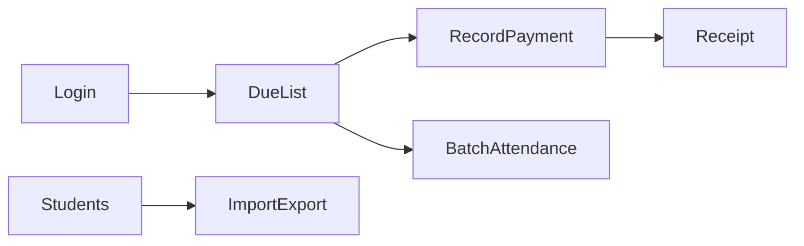

# Mockup design plan

A screen map for a later clickable prototype of the Dhaka coaching fee-and-attendance product. The position is [product-positioning.md](../market-research/school-management/product-positioning.md). The workflow is the P0 loop in [mvp-roadmap.md](../market-research/school-management/mvp-roadmap.md). The folder tree follows the admin shell in [next-cms](https://github.com/KantaPaul/next-cms).

This document adds no application code. Phase 1 interviews and Phase 3 prototype approval stay in [phase-approval-gates.md](../market-research/school-management/phase-approval-gates.md). When a prototype is built, it uses fictional rows from the sample centre below and stores no production student data.

## 1. Design ideas

The home screen is the due list. After login the owner lands on who has paid, who has paid in part, and who still owes for the open period.

The sidebar stays short:

1. Due list
2. Attendance
3. Students
4. Batches
5. Receipts
6. Reports
7. Staff
8. Settings

Three jobs share that shell. The owner checks balances in the evening. The clerk records a payment and prints a receipt. The teacher marks one batch on a phone. The nav each role sees is in section 4.

The layout copies the next-cms admin shell: route groups `(auth)` and `(admin)/dashboard/(shell)`, a left sidebar (`app-sidebar.tsx`, `dashboard-sidebar.tsx`, `nav-main.tsx`), and a header. The header shows the centre name, the open period, and an English / বাংলা toggle. On a narrow screen the sidebar collapses into the sheet pattern next-cms already uses.

Money is shown in taka, right-aligned, in tabular figures. Each obligation carries one badge: paid, partial, or due. Every money screen uses the same sample story from the roadmap: ৳1,000 gross, a ৳200 waiver, two ৳300 payments, ৳200 still due. The balance on the due list, the receipt, and the collection report is that same remainder.

Attendance is a phone-width checklist. The teacher picks a batch and a date, then marks the batch in one pass. Present and absent controls are large enough for a thumb. Fee amounts stay off this screen.

A payment opens as a sheet from a due-list row. The sheet asks for the amount, the method (cash, bKash, Nagad, or bank), and a wallet reference when the method is bKash or Nagad. A waiver is a separate sheet with a required reason. The reference is text the owner can read later. The mockup does not call a wallet API.

The receipt shows the student, the amount just recorded, the method, the reference, and the remaining balance, in the language selected in the header.

An audit list sits on the receipt. Each waiver and each payment is its own row: who, when, and the amount. The mockup shows those rows as history. It does not offer an edit that rewrites a posted row.

Export is a button on Students, the due list, Receipts, and Attendance. The button is visible to the owner. In the mockup it downloads a static sample file for that list.

## 2. Sample centre

All names, phones, and references below are fictional. They exist so every screen can show the same centre.

| Fact | Sample value |
| --- | --- |
| Centre | Green Road Coaching |
| Campus | The centre itself. One campus, no branch switcher |
| Open period | October 2026 |
| Languages | English and Bangla for navigation, the due list, and the receipt |

### Batches

| Batch | Subject | Teacher | Weekly pattern | Default fee |
| --- | --- | --- | --- | --- |
| Physics evening | Physics | Karim Hossain | Sat/Mon/Wed 5 pm | ৳1,000 |
| English evening | English | Laila Sultana | Sun/Tue/Thu 6 pm | ৳1,500 |

The weekly pattern is a text field. The mockup has no timetable grid.

### Staff

| Person | Role | Sees |
| --- | --- | --- |
| Farzana Rahman | Owner | The full nav, including exports and staff |
| Sohel Mia | Clerk | Due list, students, receipts |
| Karim Hossain | Teacher | Attendance for Physics evening |
| Laila Sultana | Teacher | Attendance for English evening |

Login for the mockup is a role picker with these four people. Passwords are out of the prototype.

### Students and October obligations

Phones are placeholders.

| Student | Guardian phone | Batch | Gross | Waiver | Payments | Balance | Badge |
| --- | --- | --- | --- | --- | --- | --- | --- |
| Nusrat Ahmed | 01700-000001 | Physics evening | ৳1,000 | ৳200, reason “sibling already enrolled” | ৳300 cash on 20 Oct; ৳300 bKash on 24 Oct, reference `BK7X9SAMPLE` | ৳200 | partial |
| Rafiq Hasan | 01700-000002 | Physics evening | ৳1,000 | none | none | ৳1,000 | due |
| Mitu Chowdhury | 01700-000003 | English evening | ৳1,500 | none | ৳1,500 cash on 18 Oct | ৳0 | paid |
| Imran Kabir | 01700-000004 | Physics evening | ৳1,000 | none | ৳1,000 bank on 22 Oct | ৳0 | paid |
| Imran Kabir | 01700-000004 | English evening | ৳1,500 | none | none | ৳1,500 | due |

Imran sits in both batches, so the due list shows two obligations.

Collection on 24 October 2026 is ৳300 (Nusrat’s bKash payment). Outstanding for the open period is ৳2,700 (Nusrat ৳200, Rafiq ৳1,000, Imran’s English ৳1,500). One obligation is partial.

Aging filters are current period, previous period, and older. October 2026 is the only period with rows. Previous period and older render an empty table with the same columns.

### Attendance on 24 October 2026

Physics evening: Nusrat present, Rafiq absent, Imran present. English evening has no session that day. The checklist still opens for a date with no class and shows an empty state that names the weekly pattern.

## 3. Flows



Owner, evening:

1. Sign in as Farzana Rahman.
2. Land on the due list for October 2026.
3. Filter to Physics evening and status partial.
4. Open Nusrat Ahmed. Read gross ৳1,000, waiver ৳200, payments ৳600, balance ৳200.
5. Record nothing further, or open the receipt for the 24 October bKash payment and read the audit rows.

Clerk, afternoon:

1. Sign in as Sohel Mia.
2. Open Rafiq Hasan on the due list.
3. Record ৳400 cash against Rafiq’s ৳1,000 obligation. The sheet preview shows ৳600 remaining after that payment. After save the balance is ৳600 and the badge is partial.
4. Open the new receipt. It shows ৳400 received and ৳600 remaining.

Teacher, before class:

1. Sign in as Karim Hossain.
2. The only nav item is Attendance.
3. Physics evening and 24 October 2026 are selected.
4. Mark the batch in one pass. Rafiq stays absent. Save shows a count of present and absent.

Owner, setup:

1. Open Students and import the sample spreadsheet. A second import of the same file reports skipped rows.
2. Open Batches and read the Physics fee of ৳1,000.
3. Open Reports and see collection today ৳300 and outstanding by batch.
4. Open Settings and switch the receipt language to Bangla. The due-list labels follow the same toggle.

## 4. Roles and navigation

| Nav item | Owner | Clerk | Teacher |
| --- | --- | --- | --- |
| Due list | Yes | Yes | Hidden |
| Attendance | Yes | Hidden | Assigned batches only |
| Students | Yes | Yes, including create and import | Hidden |
| Batches | Yes | Hidden | Hidden |
| Receipts | Yes | Yes, including print | Hidden |
| Reports | Yes | Hidden | Hidden |
| Staff | Yes | Hidden | Hidden |
| Settings | Yes | Hidden | Hidden |

The clerk records payments and prints receipts. The clerk does not delete a posted payment, does not post a waiver, and does not change roles. The teacher sees student names on the checklist and does not see fee balances. The owner posts waivers, invites staff, and exports.

`src/config/permissions.ts` holds this matrix. `src/menus/index.tsx` reads it and renders `nav-main.tsx`.

## 5. Screens

Each screen names the route, the components, the controls, and the roles that can open it.

### 5.1 Login

| | |
| --- | --- |
| Route | `src/app/(auth)/login/page.tsx` |
| Components | `src/components/templates/auth/login-form.tsx` |
| Controls | Four sample people, each labelled with a role. Choosing one enters the shell as that role |
| Roles | All four sample people |

### 5.2 Due list

The shell home. This is the product.

| | |
| --- | --- |
| Route | `src/app/(admin)/dashboard/(shell)/page.tsx` |
| Components | `_components/collection-strip.tsx`, `_components/due-list-filters.tsx`, `_components/due-list-table.tsx`, `_components/record-payment-sheet.tsx`, `_components/waiver-sheet.tsx`, `src/components/organisms/export-button.tsx` |
| Queries | `_modules/dues.queries.ts` reads `src/lib/mock/obligations.ts` |
| Controls | Batch filter, aging filter, status filter (paid, partial, due). Summary strip: collected today, outstanding this period, partial count. Columns: student, batch, guardian phone, gross, waiver, paid, balance, badge. Row actions: record payment (clerk and owner), post waiver (owner), open receipt. Owner export |
| Roles | Owner, clerk |

The Nusrat row is the first partial row when the status filter is partial. Amounts use `src/components/atoms/money-amount.tsx`.

### 5.3 Record payment

A sheet, not a separate page. It opens from a due-list row.

| | |
| --- | --- |
| Route | Stays on the due list |
| Components | `_components/record-payment-sheet.tsx` |
| Controls | Amount, method (cash, bKash, Nagad, bank), reference field when the method is bKash or Nagad, received date, remaining balance preview. Save returns to the row with the new balance. Cancel closes the sheet |
| Roles | Owner, clerk |

The preview uses `src/lib/mock/fee-balance.ts`: balance = gross − waivers − payments, in integer poisha, displayed as taka.

### 5.4 Waiver

A sheet from the same row. The reason is required. The sample waiver on Nusrat is already posted, so the sheet on her row shows the existing ৳200 reason and, for the owner, a control to post another waiver. The clerk does not see the control.

| | |
| --- | --- |
| Components | `_components/waiver-sheet.tsx` |
| Roles | Owner |

### 5.5 Receipt

| | |
| --- | --- |
| Route | `src/app/(admin)/dashboard/(shell)/receipts/[id]/page.tsx` |
| List route | `src/app/(admin)/dashboard/(shell)/receipts/page.tsx` |
| Components | `receipts/_components/receipts-table.tsx`, `receipts/[id]/_components/receipt-view.tsx`, `receipts/[id]/_components/audit-rows.tsx` |
| Controls | List columns: date, student, batch, amount, method, reference, remaining balance. The receipt page is a narrow centred sheet suitable for print: centre name, period, student, amount, method, reference, remaining balance, language of the header toggle. Audit rows under the receipt: actor, time, kind (payment or waiver), amount. Print uses the browser print dialog |
| Roles | Owner, clerk |

The Nusrat bKash receipt is the sample link from the due list. Its audit rows are the waiver, the 20 October cash payment, and the 24 October bKash payment.

### 5.6 Attendance

| | |
| --- | --- |
| Route | `src/app/(admin)/dashboard/(shell)/attendance/page.tsx` |
| Components | `attendance/_components/batch-date-bar.tsx`, `attendance/_components/attendance-checklist.tsx` |
| Actions | `attendance/_modules/attendance.actions.ts` writes the in-memory sample for the session |
| Controls | Batch select, date, one row per student with present and absent. Mark-all-present, then clear the absentees. Save shows present count and absent count. Owner export of the day’s marks. Empty state when the date is outside the weekly pattern |
| Roles | Owner for every batch. Karim Hossain for Physics evening. Laila Sultana for English evening. Clerk has no link |

The checklist is the layout to check at phone width. The shell sidebar collapses. The batch and date bar stays pinned. Fee columns are absent.

### 5.7 Students

| | |
| --- | --- |
| Route | `src/app/(admin)/dashboard/(shell)/students/page.tsx` and `students/[id]/page.tsx` |
| Components | `students/_components/students-table.tsx`, `students/_components/student-form.tsx`, `students/_components/import-students-dialog.tsx` |
| Modules | `students/_modules/students.queries.ts`, `students/_modules/students.actions.ts` |
| Controls | Table: name, guardian phone, batches, status. Create and edit collect name, guardian phone, batches, and status. Extra fields stay off the form. Import accepts the sample file and reports created and skipped counts. A second import of the same file skips the four students. Owner export. The student page lists that student’s obligations using the same balance function as the due list |
| Roles | Owner, clerk. The teacher does not open this page |

### 5.8 Batches

| | |
| --- | --- |
| Route | `src/app/(admin)/dashboard/(shell)/batches/page.tsx` and `batches/[id]/page.tsx` |
| Components | `batches/_components/batches-table.tsx`, `batches/_components/batch-form.tsx` |
| Controls | Table: name, subject, teacher, weekly pattern, default fee, student count. The form edits those fields. The pattern is text. The batch page lists students in the batch |
| Roles | Owner |

### 5.9 Reports

| | |
| --- | --- |
| Route | `src/app/(admin)/dashboard/(shell)/reports/page.tsx` |
| Components | `reports/_components/collection-report.tsx`, `reports/_components/outstanding-by-batch.tsx` |
| Controls | Date range defaulting to today, and the open period. Collection today is ৳300. Outstanding by batch uses `fee-balance.ts`, so Physics and English totals match the due list. A chart library is out of this screen |
| Roles | Owner |

### 5.10 Staff

| | |
| --- | --- |
| Route | `src/app/(admin)/dashboard/(shell)/staff/page.tsx` |
| Components | `staff/_components/staff-table.tsx`, `staff/_components/role-badge.tsx` |
| Controls | Name, phone, role (owner, clerk, teacher), and for a teacher the assigned batches. The form has no salary field |
| Roles | Owner |

### 5.11 Settings

| | |
| --- | --- |
| Route | `src/app/(admin)/dashboard/(shell)/settings/page.tsx` |
| Components | `settings/_components/centre-period-form.tsx`, `settings/_components/language-form.tsx` |
| Controls | Centre name, the single open period label, and the language default. Closing a period is represented as a status on the sample period. A closed period does not offer new payments in the mockup. The header toggle still switches the current session between English and Bangla |
| Roles | Owner |

### 5.12 Shell chrome

| | |
| --- | --- |
| Route | `src/app/(admin)/dashboard/(shell)/layout.tsx` and `src/app/layout.tsx` |
| Components | `src/components/molecules/sidebar/app-sidebar.tsx`, `dashboard-sidebar.tsx`, `nav-main.tsx`, `sidebar-logo.tsx`, `src/components/organisms/header/header.tsx`, `src/components/organisms/page-header.tsx` |
| Controls | Sidebar from `src/menus/index.tsx`. Header: “Green Road Coaching”, “October 2026”, the signed-in person, and English / বাংলা. Page header: screen title and the one primary action for that screen |
| Roles | Every signed-in person. Nav items follow section 4 |

## 6. Copy and money

`src/config/messages.ts` holds two catalogues, English and Bangla, for navigation labels, due-list column headers, payment methods, badge labels, and the receipt lines. The header toggle selects the catalogue. Dates display as 24 Oct 2026 in English. Bangla copy is part of the mockup for those same strings.

`src/lib/mock/fee-balance.ts` is the only balance rule in the mockup:

- Store amounts as integer poisha in the sample records.
- Display taka.
- Balance = gross − sum of waivers − sum of payments.
- The Nusrat obligation is 100000 poisha gross, 20000 poisha waiver, two 30000 poisha payments, 20000 poisha remaining.

The due list, the receipt, the student page, and the outstanding report all call this function.

## 7. Folder and file structure

The tree is the target layout for a later prototype. It is not in the repository as source code. Names are lowercase kebab-case, matching files such as `app-banner.tsx` and `app-sidebar.tsx`. Next.js keeps `page.tsx`, `layout.tsx`, route groups `(auth)`, `(admin)`, and `(shell)`, and dynamic segments `[id]`. Colocated private folders are `_components` and `_modules`, as in next-cms. Module files use the next-cms suffixes `*.actions.ts` and `*.queries.ts`.

Hooks are kebab-case too: `use-mobile.tsx`.

```
src/
  app/
    globals.css
    layout.tsx
    (auth)/
      layout.tsx
      login/
        page.tsx
    (admin)/
      dashboard/
        (shell)/
          layout.tsx
          page.tsx
          _components/
            collection-strip.tsx
            due-list-filters.tsx
            due-list-table.tsx
            record-payment-sheet.tsx
            waiver-sheet.tsx
          _modules/
            dues.queries.ts
          attendance/
            page.tsx
            _components/
              attendance-checklist.tsx
              batch-date-bar.tsx
            _modules/
              attendance.actions.ts
          batches/
            page.tsx
            [id]/
              page.tsx
            _components/
              batch-form.tsx
              batches-table.tsx
            _modules/
              batches.queries.ts
          receipts/
            page.tsx
            [id]/
              page.tsx
              _components/
                audit-rows.tsx
                receipt-view.tsx
            _components/
              receipts-table.tsx
            _modules/
              receipts.queries.ts
          reports/
            page.tsx
            _components/
              collection-report.tsx
              outstanding-by-batch.tsx
            _modules/
              reports.queries.ts
          settings/
            page.tsx
            _components/
              centre-period-form.tsx
              language-form.tsx
          staff/
            page.tsx
            _components/
              role-badge.tsx
              staff-table.tsx
            _modules/
              staff.queries.ts
          students/
            page.tsx
            [id]/
              page.tsx
            _components/
              import-students-dialog.tsx
              student-form.tsx
              students-table.tsx
            _modules/
              students.actions.ts
              students.queries.ts
  components/
    atoms/
      filter-toolbar/
        filter-toolbar.tsx
        filters/
          select-filter.tsx
      money-amount.tsx
      status-badge.tsx
    molecules/
      logo/
        index.tsx
      sidebar/
        app-sidebar.tsx
        dashboard-sidebar.tsx
        nav-main.tsx
        sidebar-logo.tsx
    organisms/
      export-button.tsx
      header/
        header.tsx
      page-header.tsx
    templates/
      auth/
        login-form.tsx
    ui/
      badge.tsx
      button.tsx
      card.tsx
      dialog.tsx
      dropdown-menu.tsx
      input.tsx
      label.tsx
      select.tsx
      separator.tsx
      sheet.tsx
      sidebar.tsx
      table.tsx
  config/
    messages.ts
    pages.ts
    permissions.ts
  hooks/
    use-mobile.tsx
  lib/
    mock/
      attendance.ts
      batches.ts
      centre.ts
      fee-balance.ts
      obligations.ts
      payments.ts
      staff.ts
      students.ts
    utils/
      cn.ts
      format-date.ts
      format-taka.ts
  menus/
    index.tsx
  providers/
    locale-provider.tsx
```

`src/components/ui/` is the shadcn set next-cms already keeps under that folder, reduced to the controls this mockup uses: badge, button, card, dialog, dropdown menu, input, label, select, separator, sheet, sidebar, and table.

`src/config/pages.ts` lists the eight nav hrefs. `src/config/permissions.ts` is the role matrix in section 4. `src/menus/index.tsx` joins them for `nav-main.tsx`.

Sample records live in `src/lib/mock/`. `fee-balance.ts` is the arithmetic. The other files are the rows in section 2.

### Left in next-cms

[next-cms](https://github.com/KantaPaul/next-cms) also contains a page builder, blog posts, media library, analytics boards, contact forms, and the folders `src/builder`, `src/db`, and `src/server`. Those belong to that CMS. This mockup does not add them. The patterns to copy are the route groups, `_components`, `_modules`, the sidebar molecules, the header organism, and the `ui` primitives.

## 8. Later build order

When Phase 3 allows a prototype, build in this order so an owner can click the fee desk before the surrounding lists exist:

1. Shell, sidebar, header, and the login role picker.
2. Due list with the sample obligations, filters, and collection strip.
3. Payment sheet, waiver sheet, and the Nusrat receipt with audit rows.
4. Attendance checklist at phone width.
5. Students, the import dialog, and batches.
6. Reports, staff, and settings.
7. Role-limited nav from `permissions.ts`.

The acceptance check from the roadmap stays the one to click through: a ৳1,000 fee, a ৳200 waiver, and two ৳300 payments leave ৳200 due, and the receipt shows that remainder.
